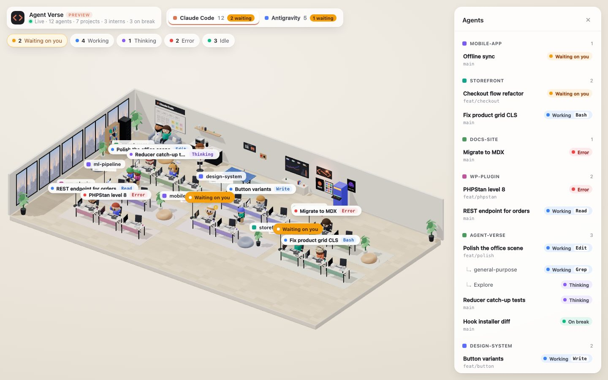
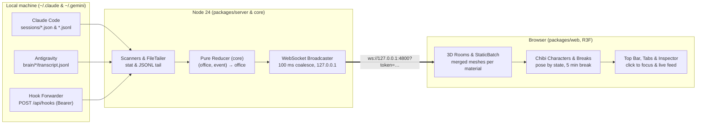
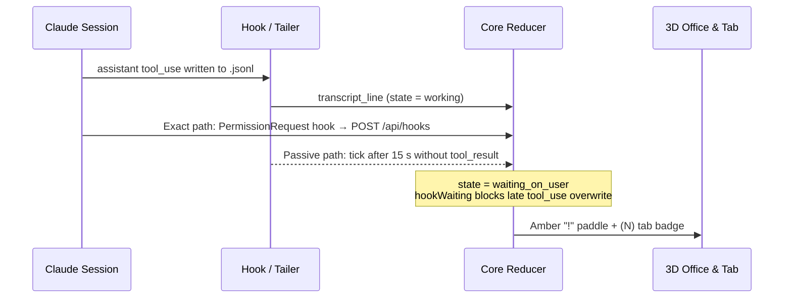

# Case study: Claude Agent Verse

**A local 3D office for watching the coding agents on my machine**

Between 7 and 11 October 2026 I designed and built [Claude Agent Verse](https://github.com/aminurislamarnob/claude-agent-verse), a local, browser-based 3D office that shows the Claude Code and Google Antigravity sessions running on my machine. Every live session sits at a desk in its project's pod, subagents pull up a chair as interns, and each character holds up an amber `!` paddle when an agent is waiting on me. I wrote **all 19 commits** on `develop` (10 pair-written with Claude Code) across 13 merged pull requests.


*The synthetic preview office (`?preview=still`) built from `develop` at 1440×900. Captured 8 Nov 2026.*

| | |
|---|---|
| **My role** | Sole developer, paired with Claude Code |
| **Repository** | 1 pnpm monorepo ([`core`](../packages/core/package.json), [`server`](../packages/server/package.json), [`web`](../packages/web/package.json)) |
| **Window** | 7 to 11 Oct 2026 (`Asia/Dhaka`) |
| **Milestone** | v1 spec complete (11 of 11 sub-issues closed) + Antigravity room |
| **Stack** | TypeScript 5.9, Node 24, React 19, Three.js, React Three Fiber, Drei, `@react-spring/three`, `ws`, Vite, Vitest |

---

## The days (7 to 11 Oct)

I built the v1 spec on 7 October in 12 commits across 8 merged pull requests (#16 to #23), starting from the pure reducer and ending the day with animated 3D characters at project desks. On 8 October I shipped 6 commits (#24 to #27 plus two direct commits) that redesigned the scene as a software studio with chibi developers, added a ping-pong zone, coffee bar and lounge for idle agents, fixed live status tracking from the session registry, and batched static meshes to cut draw calls nearly in half. The repository was quiet on 9 and 10 October. On 11 October I merged PR #29, giving Google Antigravity agents their own office room.

```
Commits per day on develop (7 to 11 Oct 2026, Asia/Dhaka):
07 Oct: ████████████ 12 commits (v1 spec #1, sub-issues #2–#12, PRs #16–#23)
08 Oct: ██████        6 commits (studio redesign, breaks, registry status, StaticBatch)
09 Oct:               0 commits
10 Oct:               0 commits
11 Oct: █             1 commit  (Antigravity room, PR #29)
```

- **19 of 19** commits on `develop` (10 paired with Claude Code)
- **13 of 13** merged pull requests
- **12 of 12** issues closed (spec #1 + sub-issues #2–#12)
- **72 of 72** Vitest unit tests passing

---

## The brief: see every blocked agent on a second monitor

I often run 10 to 20 Claude Code sessions at once across different projects, and several spawn their own subagents. Finding out which session finished its turn and which one is blocked on a permission prompt meant cycling through terminal tabs. I wrote the v1 spec in issue #1 around five rules:

- **Observe-only:** v1 never sends input to an agent, approves permissions, or stops processes. It only watches.
- **Body language over graphs:** A character's pose shows its state from across the room: typing while working, hand on chin while thinking, an amber `!` paddle held up when waiting on me, hands on head on error, and leaning back when idle.
- **Localhost and token lockdown:** The server in [`main.ts`](../packages/server/src/main.ts) binds to `127.0.0.1`, checks the `Origin` header on HTTP and WebSocket upgrades, and requires a 16-byte random startup token on the browser WebSocket and a 32-byte token on `POST /api/hooks`.
- **Credentials stay unopened:** Adapters read only session registry JSON entries (`~/.claude/sessions/*.json`), Claude project transcripts, and Antigravity's `brain/*/.system_generated/logs/transcript.jsonl`. Per-session token files and OAuth files in `~/.gemini` are never opened.
- **Defensive adapters:** Neither Claude Code's transcripts nor Antigravity's JSONL steps are a public API. Adapters skip unknown event types and malformed fields without throwing.

---

## One pure reducer between disk tailers and Three.js

I split the pnpm monorepo into three packages on Node 24: `core`, `server`, and `web`. Every state rule lives in [`packages/core/src/reducer.ts`](../packages/core/src/reducer.ts) inside a pure function [`reduce(office, domainEvent) → office`](../packages/core/src/reducer.ts#L334-L533) that does no I/O. The server scans process registries, tails JSONL transcripts, receives hook events, feeds them into `reduce`, and broadcasts the resulting `Office` over WebSocket.



Keeping `core` pure gave me a single test seam. All 44 reducer tests in [`reducer.test.ts`](../packages/core/src/reducer.test.ts) feed synthetic registry and transcript events through `reduce` and assert on the returned `Office`, while the 3D scene is checked visually through replay mode (`pnpm --filter @claude-agent-verse/server replay`) and preview mode (`?preview=still`).

---

## Day one (7 Oct): 11 sub-issues from debug list to animated 3D office

I broke the v1 spec (#1) into 11 vertical sub-issues (#2 through #12) with explicit blocked-by links and worked through them in dependency order on 7 October. Issues #2, #3, and #4 were stacked and squash-merged together with #5 in PR #16 (`331dd49`), followed by PRs #17 through #23.

- **11:21** — Initial repository commit, [`README.md`](../README.md), [`AGENTS.md`](../AGENTS.md) and [`CLAUDE.md`](../CLAUDE.md)
- **12:42** — PR #16 (closes #2–#5): monorepo, `Origin` + startup token auth, transcript states, subagents as interns
- **12:47** — PR #17 (closes #6): deterministic replay mode in [`replay.ts`](../packages/server/src/replay.ts) (`pnpm replay --fixture fixtures/basic`)
- **12:53** — PR #18 (closes #7): passive 15 s waiting-on-you inference, `(N)` tab title and favicon badge
- **13:01** — PR #19 (closes #8): hook forwarder in [`forwarder.ts`](../packages/server/src/forwarder.ts) and `POST /api/hooks` receiver with discovery file
- **13:08** — PR #20 (closes #9): `install-hooks` and `uninstall-hooks` CLI in [`hooks-cli.ts`](../packages/server/src/hooks-cli.ts) that preserves other tools' hooks
- **13:14** — PR #21 (closes #10): React Three Fiber open-plan office and project desk pods
- **13:17** — PR #22 (closes #11): click-to-focus camera target and slide-out session inspector in [`InspectorPanel.tsx`](../packages/web/src/hud/InspectorPanel.tsx)
- **16:14** — PR #23 (closes #12): 3D characters, desk props, and per-state animations (completes v1)



---

## Studio & breaks (8 Oct): chibi developers, break zones, and real registry paths

On 8 October I replaced the first-pass diorama with a single open-plan software studio in PR #24 (`615adc3`). Each session gets a deterministic chibi developer in [`Character.tsx`](../packages/web/src/scene/Character.tsx) from its session ID (skin tone, hair, hoodie, glasses, headphones), while about one developer in five wears a white taqiyah prayer cap, thobe, and Sunnah beard (`5f7a66a`). Interns wear team-coloured beanies. I also replaced `drei` Html labels with a fixed overlay portal in [`Label.tsx`](../packages/web/src/scene/Label.tsx) after finding that labels mounted before the canvas connected rendered empty, and removed ~4 MB of unused GLB files.

In PR #25 (`2d6d5b7`) and PR #26 (`259fe77`) I added a 5-minute break threshold (`breakThresholdMs`). When a session stays idle for five minutes, its character stands up, walks down the pod aisle to the ping-pong table, coffee bar, sofa, or reshaped bean bags in [`PlayZone.tsx`](../packages/web/src/scene/PlayZone.tsx) (12 spots total), and runs back to its desk as soon as new transcript activity arrives.

| State or event | Reducer rule in `packages/core` | What you see in the 3D room |
|---|---|---|
| **Working** (`tool_use`) | `state = working`, records `currentTool` and `toolStartedAt` | Typing at the mechanical keyboard, code scrolling on the display, tool pill above head |
| **Thinking** (`user` / `tool_result`) | `state = thinking`, clears `currentTool` | Hand to chin, eyes up, animated thought bubble |
| **Waiting on you** | Hook `PermissionRequest` / `Notification`, or 15 s `tick` with open tool | Surprised face, amber `!` paddle billboarded to camera, pulsing floor ring, `(N)` tab title |
| **Error** (`is_error` / `ERROR_MESSAGE`) | `state = error`, records error excerpt in 20-item feed | Hands on head, worried brows, sweat drop, red `!` badge |
| **Idle** (`assistant` text / registry idle) | `state = idle`, sets `lastActivityAt` | Leaning back with arms behind head and closed happy eyes |
| **On break** (idle ≥ 5 min) | `onBreak = true` on `tick`; any activity resets `onBreak = false` | Walks to ping-pong rally, coffee bar mug, lounge sofa, or bean bag; runs back on work |

Watching my own live sessions exposed two bugs that I fixed in PR #27 (`ff05778`). First, a session whose last transcript line was a tool call stayed stuck in `working` or `waiting_on_user` after its turn ended; I added a `session_status` event carrying the registry's own `busy`/`idle` flag so `idle` wins unless a permission hook is open. Second, project paths containing a dot (such as `.claude` or `acme.app`) missed their transcripts because Claude Code turns every non-alphanumeric character into `-` in [`projectSlug`](../packages/server/src/scanner.ts#L16-L18).

---

## Speed (8 Oct): cutting draw calls by 47% and shadow draws by 82%

With 19 live sessions open at 3200×2000, the scene issued 4,596 draw calls per frame and re-rendered the shadow map on every frame because the server broadcast a fresh copy of `Office` on every one-second tick even when nothing changed.

| Metric (19 live sessions, 3200×2000, 30 fps) | Before | After |
|---|---:|---:|
| **Total draw calls per frame** | 4,596 | 2,432 |
| **Shadow-pass draw calls** | 1,600 | 289 |
| **CPU time per frame** | 12.6 ms | 8.4 ms |

*Measured on a live office of 19 sessions at 3200×2000, 30 fps and recorded in commit `e609945`. GPU time was unchanged (fill-bound at 3200×2000).*

In commit `e609945` I made two changes:
1. **Snapshot coalescing on the server:** [`dispatch`](../packages/server/src/main.ts#L169-L214) compares the reducer's return reference (`if (office !== before)`) and coalesces broadcasts to at most one snapshot per 100 ms.
2. **Static mesh batching in the scene:** [`StaticBatch.tsx`](../packages/web/src/scene/StaticBatch.tsx) merges all static meshes under a desk or room into one `BufferGeometry` per material key while letting animated parts (`userData.live`: screens, mug steam, arcade display, ping-pong ball) stay separate.

---

## Antigravity (11 Oct): a second room for Google Antigravity agents

On 11 October I merged PR #29 (`249e1c4`) to watch Google Antigravity conversations alongside Claude Code. Each agent kind gets its own room in [`rooms.ts`](../packages/web/src/scene/rooms.ts), switched from tabs in [`TopBar.tsx`](../packages/web/src/hud/TopBar.tsx) that show per-room agent and waiting counts while the browser tab title totals every room.

- **Passive brain tailing:** Antigravity has no process registry, so [`antigravity.ts`](../packages/server/src/antigravity.ts) lists `~/.gemini/{antigravity,antigravity-ide,antigravity-cli}/brain/*` and treats a conversation as live while its `transcript.jsonl` was modified in the last 30 minutes, assigning a synthetic negative PID.
- **Stat-only workspace resolution:** Once a tool call in `transcript.jsonl` names a path outside `~/.gemini`, [`workspaceDir`](../packages/server/src/antigravity.ts#L93-L108) checks the path on disk with `stat` (so a `Makefile` or `.env` resolves to its parent folder and a directory named `acme.app` is kept) and moves the agent into its project pod.
- **Shared state reducer:** [`processAntigravityStep`](../packages/core/src/reducer.ts#L192-L256) maps `USER_INPUT`, `PLANNER_RESPONSE`, `GENERIC`, and `ERROR_MESSAGE` into the same `AgentState` values, so passive 15 s waiting inference and 5-minute breaks work without special cases.

---

## The details a visitor never sees

- **Loopback, Origin, and two tokens:** HTTP and WebSocket requests from foreign `Origin` headers get `403 Forbidden` via [`auth.ts`](../packages/server/src/auth.ts). Browser WebSockets must pass `?token=<browserToken>` (16 random bytes per start); hook forwarders authenticate with `Bearer <hookToken>` (32 random bytes stored in `~/.claude/agent-verse-discovery.json` with mode `0600` and unlinked on exit).
- **Coexisting hook installer:** [`updateHooks`](../packages/server/src/hooks-cli.ts#L44-L92) tags only its own forwarder entry (`# claude-agent-verse`) across the 10 Claude hook events (`SessionStart` through `SubagentStop`), leaving hooks from Orca, Agent Flow, or Superset untouched and backing up `.claude.json` to `.claude.json.bak` before writing.
- **5-file Vitest suite (72 tests):** 44 reducer tests in [`reducer.test.ts`](../packages/core/src/reducer.test.ts), 11 Antigravity scanner and workspace tests in [`antigravity.test.ts`](../packages/server/src/antigravity.test.ts), 9 `Origin` and token auth tests in [`auth.test.ts`](../packages/server/src/auth.test.ts), 6 hook installer tests in [`hooks-cli.test.ts`](../packages/server/src/hooks-cli.test.ts), and 2 registry scanner tests in [`scanner.test.ts`](../packages/server/src/scanner.test.ts) run in ~160 ms.

---

## Dogfooding with Claude Code on a live test subject

Because Claude Agent Verse observes Claude Code, every session I used to build the repo sat live inside the office while I worked. I wrote [`AGENTS.md`](../AGENTS.md) and [`CLAUDE.md`](../CLAUDE.md) up front so each sub-issue followed the same loop: pick the lowest-numbered unblocked ticket, write failing Vitest reducer tests first, make them pass, and check the 3D scene in replay or preview mode.

| What I specified and drove | How I used Claude Code (10 co-authored commits) |
|---|---|
| The v1 problem statement, domain model, and 11 tracer-bullet issues (#1–#12) | Writing red-first Vitest reducer and adapter tests for each ticket before implementation |
| Security boundaries: loopback bind, `Origin` check, startup tokens, and credential guardrails in `~/.claude` and `~/.gemini` | Building procedural Three.js character, furniture, and break-zone geometry in `packages/web` |
| The studio redesign brief, chibi body-language table, traditional attire (`5f7a66a`), and break-zone mechanics (#24–#26) | Implementing the `StaticBatch` geometry merger and `processAntigravityStep` reducer cases |
| Live debugging against 17–19 concurrent sessions (#27) and the `StaticBatch` + snapshot coalescing profiling (`e609945`) | Running headless Chromium verification against `?preview=still` and `pnpm replay` |
| The multi-room Antigravity design and stat-only workspace resolution (#29) | |

---

## Where it stands

- **v1 complete on `develop`:** All 11 sub-issues of spec #1 are closed, with 72 passing unit tests across `core` and `server`.
- **Two agent rooms:** Live observation for both Claude Code (registry + transcripts + optional real-time hooks) and Google Antigravity (`~/.gemini/*/brain/*/transcript.jsonl`).
- **Two-minute visual review without a server:** Appending `&preview` or `&preview=still` to the URL renders a synthetic 17-agent office across both rooms in the browser via [`preview.ts`](../packages/web/src/preview.ts).
- **Two open exploratory PRs:** Feature-animation chibi restyling (#28) and daylight + keyboard/minimap walk navigation (#30) sit on feature branches for the next iteration.

---

## Where the numbers come from

Commit counts (19 of 19, 10 with a `Co-Authored-By: Claude` trailer) are non-merge commits on `develop` in `aminurislamarnob/claude-agent-verse` from 7 to 11 October 2026 in `Asia/Dhaka`, counted with `git_stats.py`. Pull request (13 merged) and issue counts (12 closed) come from GitHub via `gh`. Three early PRs (#13, #14, #15 for issues #2, #3, #4) were stacked and squash-merged inside PR #16 (`331dd49`). Two open feature-branch PRs (#28 and #30) are not on `develop` and are excluded from the totals. Frame-cost numbers (draw calls 4,596 → 2,432, shadow-pass draws 1,600 → 289, CPU 12.6 ms → 8.4 ms, GPU unchanged) were measured on a live office of 19 sessions at 3200×2000, 30 fps and recorded in commit `e609945`. Commit counts measure activity, not effort; squash merges combine multiple branch commits into one.
